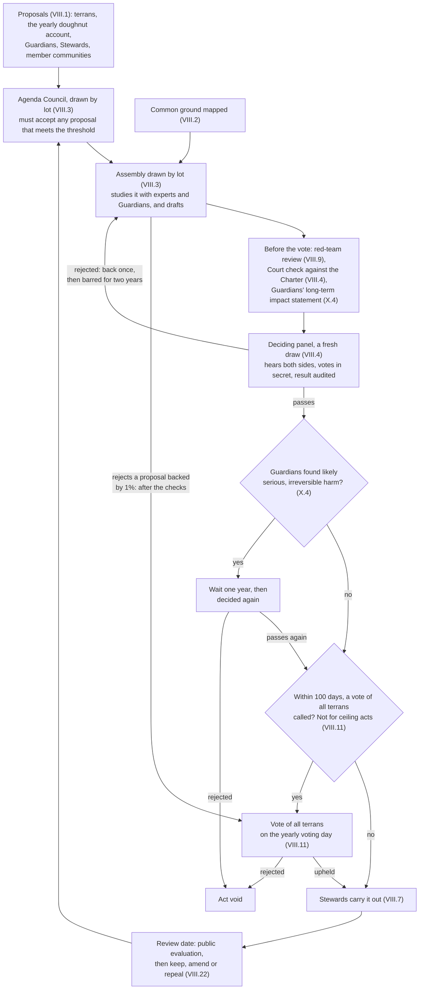

# The Terran Charter

Oct 12, 2026 · Kara Zajac

*Founding principles of Terran Humanism. Second working draft.*

## Preamble

We are terrans: one species, sharing one planet and one future.

For most of our history we have divided ourselves by nation, faith, and fortune, and treated the Earth as something to use up. That arrangement leaves billions without enough while pushing the living systems we depend on past their safe limits, risking changes that cannot be undone. We know enough now to do better.

We hold that every terran deserves enough to live with dignity, and that no one is entitled to so much that others go without. We hold that the planet's limits are not negotiable.

Between that floor and that ceiling lies a safe and just space for humanity. Within it, every terran is free to build their own utopia.

We hold that knowledge is our shared inheritance and cooperation our greatest strength. Greed is a vice to be outgrown, not an engine to be harnessed.

We are not the last terrans. We hold this planet in trust for thousands of generations still to come.

This Charter belongs to no government. It belongs to every terran who chooses to live by it, and to every community and organization that adopts it. We commit ourselves to what follows.

## Part I — Terrans

Every human being is a terran, and terrans are one people, without nations.

1. **Standing.** Every person is a terran from birth. No one grants that standing, and no one can revoke it.
2. **No nations.** Nations grew with the printing press and mass literacy, which taught strangers who would never meet to see themselves as one people. Today's networks can reach every terran, so that bond can now span the planet. The Commonwealth has no nations, only terrans.
3. **Identity.** Faith, culture, language, and ancestry remain free to flourish. None may place one terran beneath another.
4. **The Commonwealth.** The Terran Commonwealth is all terrans, living in communities of their own choosing. It is defined by shared commitments, not by territory or borders.

## Part II — The Seven Principles

These seven principles bind every terran and every institution in the Commonwealth.

**I. Compassion.** Every terran owes care to every living being, human and otherwise. That care is guided by reason: compassion without evidence becomes sentimentality, and reason without compassion becomes cruelty.

**II. Justice.** Justice is never finished. Laws and institutions are tools for pursuing it; where they produce injustice, justice prevails and they must change.

**III. Autonomy.** Each terran's body and mind belong to that terran alone. No government, community, majority, or market may claim them.

**IV. Freedom.** Every terran holds the same freedom as every other, and that freedom covers dissent, doubt, and giving offense. Those who take others' freedom without just cause cannot claim the Charter's protection for their own.

**V. Knowledge.** Belief follows evidence, never the reverse. Knowledge belongs to all terrans, to be pursued, shared, taught, and celebrated. No power may bury knowledge to protect itself.

**VI. Repair.** Every terran makes mistakes, and so does every institution, this Charter included. The duty that follows a mistake is to own it, repair the harm, and learn.

**VII. Spirit over Letter.** These principles are a compass, not a cage. Wherever the wording of this Charter conflicts with compassion, wisdom, and justice, those prevail.

## Part III — The Floor and the Ceiling

The economy exists for one purpose: bringing every terran inside the doughnut, between a social floor and an ecological ceiling, and keeping them there.

### The social floor

No terran shall fall below the floor. Every terran is entitled to:

- **Food:** enough nutritious food to thrive
- **Water:** clean water and sanitation
- **Health:** care when sick, and the conditions to stay well
- **Housing:** a safe, secure place to live
- **Energy:** clean, reliable power for daily life
- **Education:** lifelong learning and open access to human knowledge
- **Income and work:** a secure livelihood and the chance to do meaningful work
- **Resilience:** protection against disaster, illness, and loss
- **Voice:** a real say in the decisions that shape their life
- **Social equity:** fair treatment and a fair share, whoever they are
- **Gender equality:** equal rights and opportunity regardless of gender

### The ecological ceiling

No terran, community, or institution may push the planet past its limits. The Charter recognizes nine planetary boundaries:

- **Climate change**
- **Ocean acidification**
- **Introduction of novel entities:** synthetic chemicals, modified life forms, and other new substances released without adequate testing
- **Biogeochemical flows:** nitrogen and phosphorus
- **Freshwater change:** rivers and soil moisture
- **Land-system change:** forest cover
- **Change in biosphere integrity:** the variety of life, and the share of nature's growth that people take
- **Atmospheric aerosol loading:** particles in the air that shift rainfall
- **Stratospheric ozone depletion:** the ozone layer

The ceiling follows the best available science and never leaves the range it sets. Every four years an independent Earth Science Panel reviews the science and publishes a recommended range for each boundary, and the ceiling is set within that range (VIII.12). A sharing principle, adopted as an amendment to this Charter (XI.3), divides the ceiling into fair shares, with timelines for reaching them. Where a limit is already crossed, every terran, community, and institution moves toward its fair share on that timeline.

### Living alongside nature

Terrans are part of nature, not its masters. Every terran and every community does its best to live alongside the rest of life on Earth. Guardians speak for the living world in every planetary decision (Part X).

### Measuring progress

Success is measured by how many terrans live inside the doughnut and how far we stand from each boundary. It is not measured by how much is produced or owned.

*Adapted from Kate Raworth's doughnut economics and the planetary boundaries framework. Setting the ceiling draws on the Montreal Protocol.*

## Part IV — The Culture of Enough

In the Commonwealth, status comes from what a terran contributes, not what they accumulate.

1. **Greed defined.** Greed is taking or hoarding more than one needs while others fall below the floor, or while the planet is pushed past its ceiling.
2. **Shunned, not admired.** Greed is met with social disapproval, not admiration. Terrans honor those who build, teach, discover, heal, repair, and share.
3. **Enough is a virtue.** A good life is measured by flourishing, not by possession. Terrans may own homes, possessions, and savings, and live in real comfort.
4. **The wealth limit.** No terran may hold more than $10 million. Wealth above the limit passes to the Commons Fund each year. The limit sits well above a comfortable life; no one needs hundreds of millions, or a mega-yacht.
5. **A gradual climb.** The first $2 million of wealth is free of wealth tax. Above that, an annual wealth tax starts at 1% and rises toward the limit, and income is taxed on a steeply progressive scale. Terrans set the exact rates by planetary act (Part VIII).
6. **A fair burden.** Below the limit, a terran's combined taxes never take more than their income and assets earn in a year.
7. **Paying in shares.** Owners whose wealth is mostly in businesses may pay in shares, which pass to the Commons Fund, so no one must sell or close a business to pay.
8. **Nothing hidden.** Every kind of asset is reported. Wealth held through companies, trusts, or relatives counts as the owner's.
9. **The commons.** Air, water, land, and the body of human knowledge are commons. No one may enclose a commons for private gain at the cost of the floor or the ceiling. The Commons Fund holds what returns to the commons on behalf of all terrans, living and future.

*Amounts are in 2026 US dollars, adjusted each year for prices, until the Commonwealth has its own money. The wealth limit adapts Ingrid Robeyns' limitarianism.*

## Part V — Business

Businesses exist to serve terrans, and they have no political voice of their own.

1. **Organizations are not persons.** Companies, nonprofits and other organizations may own property, sign contracts, and sue or be sued, so they can always be held to account. They hold no political rights.
2. **No money in votes.** No organization may spend to influence a vote or a public decision. Individual spending on votes is capped, and the press stays free.
3. **Pay stays proportionate.** Pay above 50 times an organization's lowest full-time-equivalent pay is taxed on a steeply rising scale, and pay above 100 times goes entirely to the Commons Fund. The lowest pay counts contractors and agency, franchise, and outsourced workers; the highest counts stock and is averaged over several years.
4. **Workers become owners.** Workers earn a growing share of ownership in the organizations they work for, and long-term workers become members with a vote. The Commons Fund helps new cooperatives start, since a lack of start-up money is one of the barriers that keep them rare.
5. **Workers have a voice.** In larger organizations, workers elect at least a third of the board.

*Worker ownership draws on Mondragon's cooperatives and on employee-ownership plans; board seats draw on Germany's codetermination.*

## Part VI — A Utopia of Utopias

Every terran has the right to build their own utopia, and the Commonwealth exists to make that possible.

1. **The right.** Every terran may pursue the life they believe is good, alone or alongside others who share their vision.
2. **Communities.** Terrans may form communities around any vision of the good life that respects the Seven Principles, the floor, and the ceiling.
3. **Exit.** Every terran may leave any community. No vision of utopia may be imposed on anyone who has not chosen it.
4. **The Commonwealth's role.** The Commonwealth chooses no utopia for anyone. It guarantees the floor, protects the ceiling, and ensures every terran has the health, education, and resources to pursue their own.
5. **The limit.** One terran's utopia ends where it would push another below the floor, take another's freedom, or push the planet past its ceiling.

## Part VII — Working Together

Terrans govern themselves cooperatively, openly, and digitally, and every institution answers to the same test.

1. **Cooperation first.** Competition has its place, but never at the cost of the floor, the ceiling, or another terran's freedom.
2. **Digital citizenship.** Every terran holds a secure digital identity from birth. Through it they vote, use public services, and take part in decisions from anywhere on Earth. Every service and every vote also has a non-digital route, so no one is shut out.
3. **Decided by samples, checked by all.** Terrans decide planetary questions through panels of terrans drawn by lot, chosen fresh for each decision. Enough terrans together can send any planetary act except a ceiling act to a vote of all terrans, and this Charter changes only by such votes, as Part VIII sets out.
4. **Decisions close to home.** Decisions are made as close as possible to the people they affect. The Commonwealth decides only what this Charter lists as planetary:
    - the ceiling and its fair shares;
    - the ban on weapons of mass destruction, and its verification;
    - minimum defences against pandemics and other threats where the world is only as safe as its weakest point;
    - financing the floor, the wealth limit, the Commons Fund, and planetary revenue;
    - common standards for identity, voting, and measurement;
    - the Commonwealth's own money, if it has one.

    Everything else belongs to communities. The Planetary Court settles what is planetary, and must rule within 90 days when a quarter of the Council of Communities object that an act is not planetary.
5. **Open logs.** Public decisions, public spending, and amendments to this Charter are recorded on open, tamper-evident logs, run and monitored by several independent bodies, using blockchain only where no single operator can be trusted.
6. **Transparency scales with power.** The more wealth or power a terran or institution holds, the more of it is open to view. Everyday private life stays private.
7. **The doughnut test.** Every institution, from a small business to a planetary assembly, answers one question: does it bring more terrans inside the doughnut and keep them there? Each year the Statistics Office publishes the doughnut account. A worsening indicator triggers a review by the Guardians, with a deadline, and institutions follow the Guardians' recommendations or explain why not (X.5).

*Digital citizenship draws on Estonia's digital government; the short planetary list draws on the Swiss and Nigerian constitutions; open logs draw on Certificate Transparency.*

## Part VIII — How Terrans Decide

Terrans make planetary decisions through panels drawn by lot, after open deliberation. Enough terrans together can force a vote of all terrans, and no single body holds enough power to rule alone.

A panel that rejects an act sends it back to its assembly once. If the Guardians find likely serious, irreversible harm, the act waits a year and is decided again. Enough terrans can call any act except a ceiling act to a vote of all terrans; the Stewards act once no vote is called, or once the vote upholds it.

1. **Anyone may propose.** Any terran may put forward a proposal, and so may the Stewards, the Guardians, and member communities. A proposal backed by 100,000 terrans of voting age receives a reasoned public answer from the Agenda Council within 90 days. One backed by one million terrans of voting age across a quarter of the regions goes to an assembly. If the assembly rejects a proposal backed by 1% of terrans of voting age, the proposal goes to a vote of all terrans on the yearly voting day, after the checks in VIII.4. Proposals on the ceiling cannot take this route. Signatures count if they are gathered within twelve months.
2. **Common ground first.** Open online discussion maps where terrans agree and disagree, so debate starts from what they share. Every assembly takes the maps as input.
3. **Assemblies chosen by lot.** For each planetary power listed in VII.4, a standing assembly of 450 terrans drawn by lot studies proposals with experts and Guardians and drafts planetary law. A Budget Assembly of 450 drafts the planetary budget and reconciles acts that conflict. An Agenda Council of 300, also drawn by lot, assigns proposals to assemblies; it must accept any proposal that meets VIII.1's one-million threshold, and publishes its reasons. Members of the assemblies and the Agenda Council serve three years, a sixth replaced every six months. Different people recruit, brief, and facilitate members, and all are rotated and audited.
4. **Terrans decide.** Each act an assembly drafts goes, exactly as the assembly wrote it, to a fresh panel of at least 1,000 terrans drawn by lot. Before the vote, the Planetary Court checks the act against this Charter, and an act that fails returns to its assembly. The panel hears advocates for and against, chosen by the assembly's majority and minority, then votes in secret. A majority decides, except where this Charter requires more. An act a panel rejects returns to its assembly once; if rejected again, it may not return for two years.
5. **Secure votes.** A terran's digital identity proves they may vote but never reveals how they voted. Terrans may vote online or in person. An in-person vote is final and replaces any online vote, whenever cast. Among online votes, the last counts. Online voting closes before in-person voting does, so a vote made online under pressure can be replaced until voting closes.
6. **Every vote is checked.** Every result is audited before it takes effect. Where an audit fails, the paper record is counted by hand. A new vote is held only if there is no paper record, or it is lost, and the missing votes could change the result. Votes that change this Charter are also cast on paper, so they never depend on software alone. Voting keys and systems are held by five independent bodies, any three of which can act together, so no single failure can lose a vote.
7. **Stewards carry out decisions.** A Council of seven Stewards carries out planetary acts, holds no veto over them, and commands no army. No more than two come from one region. Each heads a department and serves one six-year term, counting any part of a term; two or three seats are filled every two years. Stewards are chosen from a certified pool (VIII.17) after public hearings, with the approval of both the Oversight Council (VIII.14) and the Council of Communities (VIII.13), and either council may remove one by two-thirds. A Steward whose term ends stays until a successor is approved. A seat still unfilled six months after a term ends or falls vacant is filled by lot from candidates either council approved. The Stewards lead a civil service hired by open competition and protected from political dismissal.
8. **Separate powers.** Assemblies drawn by lot draft planetary law, and panels drawn by lot decide it; the Council of Communities holds a second key; the Stewards and the civil service administer, and make rules only under an act; courts judge; and Guardians speak for those who cannot vote. No person or body holds more than one of these powers. The Ombudsman council oversees them all.
9. **The Ombudsman council.** An independent Ombudsman council of five, drawn by lot from certified candidates (VIII.17), may investigate any institution, including the courts and those who enforce this Charter. Its red team publishes an adversarial review of each major planetary proposal before it is decided. Ombudsmen serve fixed terms, may be removed only for proven misconduct, and are succeeded automatically. The council's budget is a fixed share of planetary revenue that no vote or official can cut, and the Planetary Court hears complaints against it.
10. **Free to move and to dissent.** Every terran may move to any community, and may organize peaceful opposition to any decision.
11. **A vote of all terrans.** An act a panel passes takes effect unless, within 100 days, 0.5% of terrans of voting age across a quarter of the regions, or a quarter of the Council of Communities, call a vote of all terrans. Ceiling acts cannot be called to such a vote. Votes of all terrans are held together on one voting day each year, and a challenged act waits until then. The assembly concerned words the question and writes a fair summary, with the case for and against in each side's own words. Terrans of voting age, as a planetary act sets it, may sign and vote.
12. **The ceiling.** Ceiling acts set limits within the Earth Science Panel's range (Part III). Each needs two-thirds of a panel of at least 3,000, and a majority of the Council of Communities, including a majority of delegates from lower-footprint regions and a majority from higher-footprint regions. The Statistics Office classes regions each year by their footprint per person on the planetary boundaries. If the Planetary Court finds a ceiling act outside the science's range, the act is void. A planetary fund pays poorer communities' costs of complying.
13. **The Council of Communities.** Member communities are the communities, cities, and nations that have adopted this Charter (XII.1). The Council of Communities has 200 delegates, shared among the regions by population, with at least two each. Each region's member communities choose its delegates by their own methods. Delegates serve staggered terms of up to four years and can be recalled. The Council holds the powers this Charter gives it in VII.4, VIII.7, VIII.11, VIII.12, VIII.15, and XII.8.
14. **The Oversight Council.** The Oversight Council has 150 terrans drawn by lot, serving staggered two-year terms. It holds public hearings with candidates for Steward, approves or removes Stewards with the Council of Communities, and reviews the Stewards' work in public. Its members may not become Stewards within five years, and the Planetary Court may remove a member for misconduct.
15. **Rules under an act.** The Stewards and the civil service may make detailed rules only under a planetary act that says what is routine. Each draft is published, and only comments from verified or sampled terrans count. A panel of 200 terrans drawn by lot reviews it for the assembly whose power it falls under. The rule takes effect after an objection window unless that assembly calls it in. A call-in can be forced by 100,000 terrans of voting age or a tenth of the Council of Communities.
16. **Drawn fairly.** Every draw by lot uses a public random seed, is run in parallel by at least three independent operators, and can be reproduced by anyone. No body oversees the draws for its own seats. Draws from all terrans are stratified by region, age, gender, education, and language. The identity register behind them is kept by at least two independent custodians, audited yearly, with a paper fallback. Service by lot is voluntary, paid, and protected: no one may lose their work or their home for serving, and members of a deciding panel are named only after their vote. Wherever this Charter counts regions, it means the world regions in its schedule.
17. **Certified candidates.** Candidates for Steward, judge, ombudsman, and the independent offices are certified against criteria published in advance by planetary act. Anyone who meets the criteria may enrol on an open roster. Each certifying panel is drawn for one round, with a majority drawn by lot from all terrans and experts drawn from the rosters. Panels publish their reasons, no one sits on two, and a refusal can be appealed to the Planetary Court.
18. **Independent offices.** The Audit Office, the Statistics Office, the Identity and Voting Office, and the Earth Science Panel are independent. Their members are drawn by lot from certified candidates, and the Earth Science Panel adds lay reviewers drawn by lot. Members serve fixed terms, may be removed only for proven misconduct, and take no orders from the Stewards. Each office's budget is a fixed share of planetary revenue.
19. **Emergencies expire.** The Council of Stewards, by a majority, may declare an emergency for a hazard on a list adopted in advance by planetary act. An emergency lasts up to 21 days and is published at once. It ends unless confirmed within seven days by a panel drawn from an emergency pool, which is drawn by lot each year. A fresh panel from the pool decides each extension, and an extension lasts at most three months. The first extension needs a majority, the second 60%, and each later one ten points more. None may follow one passed at 90%.
20. **Limits on emergencies.** Any measure that suspends a right or bypasses ordinary procedure is an emergency measure, whatever law it uses. The Planetary Court may review any emergency or measure. No emergency may change this Charter, postpone a vote, or stop the Court or the Ombudsman council. Every emergency measure lapses with the emergency, and an inquiry with hearing powers follows.
21. **Continuity.** If the Council of Stewards, the Oversight Council, or the Council of Communities cannot act, a fresh panel from the emergency pool acts in its place for at most 90 days. It may not change this Charter, postpone a vote, or extend itself.
22. **Decisions are versions.** Every planetary act carries a version number, a public history, and a review date. At review it is evaluated in public, and stays in force unless a deciding panel passes an amendment or repeal drafted by its assembly. Emergency measures, urgent acts, and acts that say so lapse unless renewed. Ceiling limits and the ban on weapons of mass destruction never lapse, and ceiling limits loosen only as the science allows.
23. **Urgent acts.** A deciding panel may make an act urgent, so that it takes effect at once, without the waits in VIII.11 and X.4. An urgent act carries an end date and lapses within a year unless it is ratified through the ordinary process, waits included. Once refused, it may not be renewed.
24. **Rules anyone can run.** Rules that set numbers, such as tax bands, the wealth limit, pay ratios, and eligibility for the floor, are also published as code anyone can run. Where code and text differ, the text prevails. Any adverse decision gets a human review on request.

*Assemblies chosen by lot draw on Ireland's citizens' assemblies and Ostbelgien's standing citizens' council, and mapping common ground on Taiwan's vTaiwan. Deciding panels draw on Mongolia's deliberative polls, and the vote of all terrans on Switzerland's optional referendum. The Council of Stewards draws on Switzerland's Federal Council, and public draws follow the IETF's verifiable lotteries. Emergency limits draw on South Africa's constitution and Switzerland's urgent laws, and versioned decisions on open-source projects. The Ombudsman council draws on Sweden's Ombudsman, the first, and on the Earth Constitution's council of five.*

## Part IX — Accountability

The Charter is enforced in the open, what was taken is reclaimed, and punishment exists to restore, not to destroy.

1. **The Planetary Court.** A Planetary Court hears cases under this Charter, and any terran may bring one. Community courts settle local matters, with appeal to the Planetary Court on questions under this Charter. The Court also settles disputes between communities.
2. **Judges.** Judges are chosen by an assembly drawn by lot for that purpose, from candidates certified as qualified (VIII.17). The Court has fifteen judges. Each serves one twelve-year term, staggered, and is seated automatically once chosen. A judge may be removed only for proven misconduct, by two-thirds of the other judges after an independent review.
3. **Independent inspectors.** Inspectors investigate breaches of this Charter. They answer to the Court, not to the Stewards. Their budget is a fixed share of planetary revenue.
4. **Fair process.** No terran is punished without an open hearing, the evidence laid out, and the chance to answer.
5. **People answer, not populations.** Penalties fall on the people and institutions responsible, never on whole communities. No institution can shield the people who direct it: those who knowingly use it to push terrans below the floor or the planet past the ceiling answer personally.
6. **Enforcement without armies.** The Commonwealth enforces first by publishing findings, then by withholding its funds and benefits, then by reclaiming assets. Only a court may order an arrest, and peace officers carry only what they need to detain an individual.
7. **Reclaiming the commons.** Wealth that escapes the Charter's taxes, or is gained by breaking the floor or the ceiling, is reclaimed and returned to the commons.
8. **Justice that restores.** Punishment exists to repair harm, protect others, and return the person to the community, never for revenge (Principle VI).
9. **Humane confinement.** Liberty is taken only when needed to protect others (Principle IV). Life inside stays as close to normal life as possible, with dignity, education, work, and a path home.
10. **Watching the watchers.** The Ombudsman council oversees the courts, inspectors, and peace officers. Every enforcement action is recorded on the open logs, except where a victim's privacy requires otherwise.

*Enforcement through courts and the withholding of benefits draws on the European Union; arrest-only policing draws on the Constitution for the Federation of Earth, though here only a court may order an arrest; confinement draws on Norway's rehabilitative prisons.*

## Part X — The Long View

Terrans plan as a species that intends to live for tens of thousands of generations and millions of years.

1. **Future terrans.** Terrans not yet born are terrans too. Their claim on the floor and the ceiling is as strong as ours.
2. **No gambling the future.** No generation may spend down what later generations need, or take risks that could end the human story.
3. **Guardians.** Guardians speak for future terrans and for the living world, because neither can vote. Half are drawn by lot from among all terrans and half are nominated by scientific bodies. Each serves one ten-year term, and successors are chosen automatically so no seat sits empty.
4. **The long-view test.** Every planetary act is weighed for its effects across generations, not only on the terrans alive today. Each carries the Guardians' long-term impact statement, prepared by independent scientists. If the Guardians find likely serious, irreversible harm, the act waits one year and is decided again: by a fresh panel or, if all terrans passed it, by a new vote of all terrans.
5. **Follow or explain.** Every institution must follow the Guardians' recommendations or publicly explain why not.
6. **Precaution.** Guardians may bring cases before the Planetary Court. Whoever proposes an activity that risks serious or lasting harm must show that it is safe.
7. **Protected and accountable.** The Guardians' budget is a fixed share of planetary revenue that no vote or official can cut. Guardians are bound by duties of care, and the Court and the Ombudsman council oversee them as they oversee everyone else.

*Guardians draw on Wales' Future Generations Commissioner and New Zealand's river guardians; speaking for nature draws on Ecuador's rights of nature, and the burden of proof on Ecuador's constitution (Article 397) and the Wingspread Statement.*

## Part XI — A Living Charter

This Charter can be wrong, so it is built to change.

1. **Revision.** The Charter is revised as knowledge grows (Principle V) and as its mistakes come to light (Principle VI).
2. **Interpretation.** It is always read by its spirit (Principle VII).
3. **How it changes.** An amendment passes only with two-thirds of the votes in two votes of all terrans, held at least a year apart. An assembly drafts each amendment, the Planetary Court checks it against XI.4, and it carries the Guardians' long-term impact statement.
4. **Limits on amendment.** No amendment may lower the floor or weaken any terran's protection under the Seven Principles. No amendment may set the ceiling outside the range the science supports.
5. **A review each generation.** Every 25 years, an assembly drawn by lot reviews the whole Charter and proposes changes to all terrans.

## Part XII — Becoming the Commonwealth

The Commonwealth grows by choice and in stages, never by force, until nations are no longer needed.

1. **Joining.** Any terran may take up digital citizenship in the Commonwealth from anywhere, before their nation joins. Communities, cities, organizations, and nations join by adopting this Charter.
2. **Stage one: shared limits.** Joining nations hand their weapons of mass destruction to the Commonwealth to be dismantled, commit to the ecological ceiling, and accept the Planetary Court's authority over breaches of this Charter.
3. **Stage two: the floor and the commons.** When half of humanity has joined, the Commonwealth takes on the social floor, the wealth limit, and planetary revenue.
4. **Stage three: one Commonwealth.** When nine in ten terrans have joined, national armies are dismantled and nations become self-governing communities within the Commonwealth.
5. **Leaving.** Until stage three, any member may leave. The Planetary Court keeps its authority over acts committed while it was a member.
6. **Never by force.** The Commonwealth grows by what it offers, such as the floor, open knowledge, and a voice for every terran, never by conquest.
7. **Proven before binding.** Each assembly and its panels begin in advisory form, except those for the ceiling, the ban on weapons of mass destruction, and the standards for identity and voting. An assembly gains binding power only when the Audit Office finds that it meets criteria published in advance. Until then, its acts also need approval in a vote of all terrans.
8. **A way out if safeguards fail.** After stage three, the Ombudsman council or a quarter of the Council of Communities may certify that a scheduled vote was postponed, an emergency ran past its last permitted extension, or the Court could not sit for 90 days. Any community may then leave Commonwealth institutions. Its people keep their floor rights, it keeps its ceiling duties, and the Planetary Court keeps its authority over acts committed before it left.
9. **Who counts until stage three.** Until stage three, Part VIII counts only terrans who have joined, by living in a member community or by taking up digital citizenship.
10. **Funding until stage two.** Until the Commonwealth takes on planetary revenue, members fund its bodies by assessed shares in proportion to their means, published every year.

*The stages draw on the Constitution for the Federation of Earth; joining from anywhere draws on Estonia's e-Residency; authority that survives leaving draws on the International Criminal Court.*

## Schedule — World regions

Not yet chosen. Wherever this Charter counts regions, it means at least ten world regions, starting from an existing statistical classification. Only an amendment to this Charter changes them.

## Open questions for the next draft

- [ ] **The numbers:** Are the proposed figures right: a $10 million wealth limit, the first $2 million free of wealth tax, pay limits at 50 and 100 times the lowest pay, and the sizes, terms, and thresholds this draft sets in Parts VIII, IX, and XII?
- [ ] **Paper votes:** Votes that change this Charter are cast on paper too. Should every vote of all terrans also be cast on paper until online voting can be fully secured?
- [ ] **Transition:** Are half and nine in ten of humanity the right points for stages two and three?
- [ ] **Money:** With no nations, what money does the Commonwealth use in place of US dollars?
- [ ] **Leaving after stage three:** Beyond the safeguard in XII.8, may a community ever leave by choice once nations are gone, and on what terms?
- [ ] **Sharing the ceiling:** By what principle is the ceiling divided into fair shares, and on what timelines?
- [ ] **Regions:** Which classification should start the world regions in the schedule?
- [ ] **Voting age and service:** What is the voting age, and how is service by lot paid?

Research behind this draft: [Research](research/README.md) · [The government design](proposals/modern-terran-government.md)

---

*To the extent possible under law, Kara Zajac has waived all copyright and related or neighboring rights to The Terran Charter. ([CC0 1.0 Universal](https://creativecommons.org/publicdomain/zero/1.0/))*
