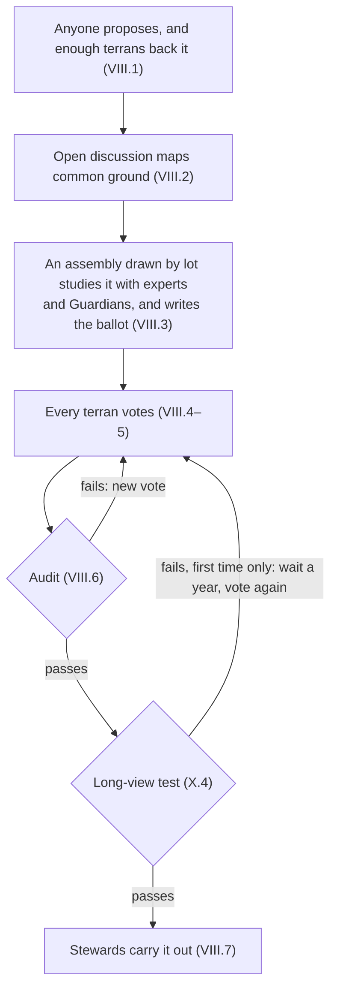

# The Terran Charter

Oct 10, 2026 · Kara Zajac

*Founding principles of Terran Humanism. Working draft.*

## Preamble

We are terrans: one species, sharing one planet and one future.

For most of our history we have divided ourselves by nation, faith, and fortune, and treated the Earth as something to use up. That arrangement leaves billions without enough while pushing the living systems we depend on toward collapse. We know enough now to do better.

We hold that every terran deserves enough to live with dignity, and that no one is entitled to so much that others go without. We hold that the planet's limits are not negotiable.

Between that floor and that ceiling lies a safe and just space for humanity. Within it, every terran is free to build their own utopia.

We hold that knowledge is our shared inheritance and cooperation our greatest strength. Greed is a vice to be outgrown, not an engine to be harnessed.

We are not the last terrans. We hold this planet in trust for thousands of generations still to come.

This Charter belongs to no government. It belongs to every terran who chooses to live by it, and to every community and organization that adopts it. We commit ourselves to what follows.

## Part I — Terrans

Every human being is a terran, and terrans are one people, without nations.

1. **Standing.** Every person is a terran from birth. No one grants that standing, and no one can revoke it.
2. **No nations.** Nations were built for a world where news moved at the speed of a horse. Instant communication has made us one people, so the Commonwealth has no nations, only terrans.
3. **Identity.** Faith, culture, language, and ancestry remain free to flourish. None may place one terran beneath another.
4. **The Commonwealth.** The Terran Commonwealth is all terrans, living in communities of their own choosing. It is defined by shared commitments, not by territory or borders.

## Part II — The Seven Principles

These seven principles bind every terran and every institution in the Commonwealth.

**I. Compassion.** Every terran owes care to every living being, human and otherwise. That care is guided by reason: compassion without evidence becomes sentimentality, and reason without compassion becomes cruelty.

**II. Justice.** Justice is never finished. Laws and institutions are tools for pursuing it; where they produce injustice, justice prevails and they must change.

**III. Autonomy.** Each terran's body and mind belong to that terran alone. No government, community, majority, or market may claim them.

**IV. Freedom.** Every terran holds the same freedom as every other, and that freedom covers dissent, doubt, and giving offense. Those who take others' freedom without just cause cannot claim the Charter's protection for their own.

**V. Knowledge.** Belief follows evidence, never the reverse. Knowledge belongs to all terrans, to be pursued, shared, taught, and celebrated. No power may bury knowledge to protect itself.

**VI. Repair.** Every terran makes mistakes, and so does every institution, this Charter included. The duty that follows a mistake is to own it, repair the harm, and learn.

**VII. Spirit over Letter.** These principles are a compass, not a cage. Wherever the wording of this Charter conflicts with compassion, wisdom, and justice, those prevail.

## Part III — The Floor and the Ceiling

The economy exists for one purpose: bringing every terran inside the doughnut, between a social floor and an ecological ceiling, and keeping them there.

### The social floor

No terran shall fall below the floor. Every terran is entitled to:

- **Food:** enough nutritious food to thrive
- **Water:** clean water and sanitation
- **Health:** care when sick, and the conditions to stay well
- **Housing:** a safe, secure place to live
- **Energy:** clean, reliable power for daily life
- **Education:** lifelong learning and open access to human knowledge
- **Income and work:** a secure livelihood and the chance to do meaningful work
- **Resilience:** protection against disaster, illness, and loss
- **Voice:** a real say in the decisions that shape their life
- **Social equity:** fair treatment and a fair share, whoever they are
- **Gender equality:** equal rights and opportunity regardless of gender

### The ecological ceiling

No terran, community, or institution may push the planet past its limits. The Charter recognizes nine planetary boundaries:

- Climate change
- Ocean acidification
- Chemical pollution
- Nitrogen and phosphorus overload
- Freshwater use
- Land use change
- Biodiversity loss
- Air pollution (atmospheric aerosol loading)
- Ozone depletion

The ceiling follows the best available science and moves only as that science does.

### Living alongside nature

Terrans are part of nature, not its masters. Every terran and every community does its best to live alongside the rest of life on Earth. Guardians speak for the living world in every planetary decision (Part X).

### Measuring progress

Success is measured by how many terrans live inside the doughnut and how far we stand from each boundary. It is not measured by how much is produced or owned.

*Adapted from Kate Raworth's doughnut economics and the planetary boundaries framework.*

## Part IV — The Culture of Enough

In the Commonwealth, status comes from what a terran contributes, not what they accumulate.

1. **Greed defined.** Greed is taking or hoarding more than one needs while others fall below the floor, or while the planet is pushed past its ceiling.
2. **Shunned, not admired.** Greed is met with social disapproval, not admiration. Terrans honor those who build, teach, discover, heal, repair, and share.
3. **Enough is a virtue.** A good life is measured by flourishing, not by possession. Terrans may own homes, possessions, and savings, and live in real comfort.
4. **The wealth limit.** No terran may hold more than $10 million. Wealth above the limit passes to the Commons Fund each year. The limit sits well above a comfortable life; no one needs hundreds of millions, or a mega-yacht.
5. **A gradual climb.** The first $2 million of wealth is free of wealth tax. Above that, an annual wealth tax starts at 1% and rises toward the limit, and income is taxed on a steeply progressive scale. Terrans set the exact rates by vote.
6. **A fair burden.** Below the limit, a terran's combined taxes never take more than their income and assets earn in a year.
7. **Paying in shares.** Owners whose wealth is mostly in businesses may pay in shares, which pass to the Commons Fund, so no one must sell or close a business to pay.
8. **Nothing hidden.** Every kind of asset is reported. Wealth held through companies, trusts, or relatives counts as the owner's.
9. **The commons.** Air, water, land, and the body of human knowledge are commons. No one may enclose a commons for private gain at the cost of the floor or the ceiling. The Commons Fund holds what returns to the commons on behalf of all terrans, living and future.

*Amounts are in 2026 US dollars, adjusted each year for prices, until the Commonwealth has its own money. The wealth limit draws on Ingrid Robeyns' limitarianism.*

## Part V — Business

Businesses exist to serve terrans, and they have no political voice of their own.

1. **Organizations are not persons.** Companies, nonprofits and other organizations may own property, sign contracts, and sue or be sued, so they can always be held to account. They hold no political rights.
2. **No money in votes.** No organization may spend to influence a vote or a public decision. Individual spending on votes is capped, and the press stays free.
3. **Pay stays proportionate.** Pay above 50 times an organization's lowest full-time pay is taxed on a steeply rising scale, and pay above 100 times goes entirely to the Commons Fund. The lowest pay counts contractors and outsourced workers; the highest counts stock and is averaged over several years.
4. **Workers become owners.** Workers earn a growing share of ownership in the organizations they work for, and long-term workers become members with a vote. The Commons Fund helps new cooperatives start, since a lack of start-up money is a main reason so few exist.
5. **Workers have a voice.** In larger organizations, workers elect at least a third of the board.

*Worker ownership draws on Mondragon's cooperatives and on employee-ownership plans; board seats draw on Germany's codetermination.*

## Part VI — A Utopia of Utopias

Every terran has the right to build their own utopia, and the Commonwealth exists to make that possible.

1. **The right.** Every terran may pursue the life they believe is good, alone or alongside others who share their vision.
2. **Communities.** Terrans may form communities around any vision of the good life that respects the Seven Principles, the floor, and the ceiling.
3. **Exit.** Every terran may leave any community. No vision of utopia may be imposed on anyone who has not chosen it.
4. **The Commonwealth's role.** The Commonwealth chooses no utopia for anyone. It guarantees the floor, protects the ceiling, and ensures every terran has the health, education, and resources to pursue their own.
5. **The limit.** One terran's utopia ends where it would push another below the floor, take another's freedom, or push the planet past its ceiling.

## Part VII — Working Together

Terrans govern themselves cooperatively, openly, and digitally, and every institution answers to the same test.

1. **Cooperation first.** Competition has its place, but never at the cost of the floor, the ceiling, or another terran's freedom.
2. **Digital citizenship.** Every terran holds a secure digital identity from birth. Through it they vote, use public services, and take part in decisions from anywhere on Earth.
3. **Direct democracy.** Terrans decide directly. Every terran votes on the questions before the Commonwealth, using their secure digital identity, as Part VIII sets out.
4. **Decisions close to home.** Decisions are made as close as possible to the people they affect. Community matters are settled by communities; planetary matters, including the ceiling, are settled by all terrans together.
5. **Open ledgers.** Public decisions, public spending, and amendments to this Charter are recorded on open, tamper-evident ledgers, using blockchain wherever it truly helps.
6. **Transparency scales with power.** The more wealth or power a terran or institution holds, the more of it is open to view. Everyday private life stays private.
7. **The doughnut test.** Every institution, from a small business to a planetary assembly, answers one question: does it bring more terrans inside the doughnut and keep them there?

*Digital citizenship draws on Estonia's digital government.*

## Part VIII — How Terrans Decide

Terrans make planetary decisions directly, after open deliberation, and no single body holds enough power to rule alone.

<!-- Reconstructed from the caption below and Parts VIII and X. The drafting doc's embedded drawing did not survive export. -->

A failed audit sends a proposal to a new vote, and a failed long-view test means a second vote a year later; only then do the Stewards act.

1. **Anyone may propose.** Any terran may put forward a proposal. A proposal backed by enough terrans goes to an assembly.
2. **Common ground first.** Open online discussion maps where terrans agree and disagree, so debate starts from what they share.
3. **Assemblies chosen by lot.** For each proposal, a Terran Assembly drawn by lot to mirror humanity studies it with experts and Guardians. It may improve the proposal, and it writes the ballot question and a fair summary of the arguments.
4. **Terrans decide.** Every terran votes on the proposal exactly as the assembly wrote it. A majority decides, except where this Charter requires more.
5. **Secure votes.** A terran's digital identity proves they may vote but never reveals how they voted. Terrans may vote online or in person. A later vote replaces an earlier one, and a vote cast in person replaces any cast online, so a vote made under pressure can always be changed.
6. **Every vote is checked.** Every result is audited before it takes effect, and a failed audit means a new vote. Votes that change this Charter are also cast on paper, so they never depend on software alone. Voting keys and systems are held by several independent bodies, so no single failure can lose a vote.
7. **Stewards carry out decisions.** A Council of Stewards, elected by all terrans for one fixed term, runs day-to-day administration. It carries out what terrans decide, holds no veto, and commands no army.
8. **Separate powers.** Terrans and their assemblies make law, Stewards administer, courts judge, and Guardians speak for those who cannot vote. No person or body holds more than one of these powers.
9. **The Ombudsman.** An independent Ombudsman may investigate any institution, including the courts and those who enforce this Charter.
10. **Free to move and to dissent.** Every terran may move to any community, and may organize peaceful opposition to any decision.

*Assemblies chosen by lot draw on Ireland's citizens' assemblies; mapping common ground draws on Taiwan's vTaiwan; the Council of Stewards and the Ombudsman draw on the Constitution for the Federation of Earth.*

## Part IX — Accountability

The Charter is enforced in the open, what was taken is reclaimed, and punishment exists to restore, not to destroy.

1. **The Planetary Court.** A Planetary Court hears cases under this Charter, and any terran may bring one. Community courts settle local matters, with appeal to the Planetary Court.
2. **Judges.** Judges are chosen by an assembly drawn by lot, from qualified candidates. Each serves one long term and may be removed only for proven misconduct, after an independent review.
3. **Independent inspectors.** Inspectors investigate breaches of this Charter. They answer to the Court, not to the Stewards.
4. **Fair process.** No terran is punished without an open hearing, the evidence laid out, and the chance to answer.
5. **People answer, not populations.** Penalties fall on the people and institutions responsible, never on whole communities. No institution can shield the people who direct it: those who knowingly use it to push terrans below the floor or the planet past the ceiling answer personally.
6. **Enforcement without armies.** The Commonwealth enforces first by publishing findings, then by withholding its funds and benefits, then by reclaiming assets. Only a court may order an arrest, and peace officers carry only what they need to detain an individual.
7. **Reclaiming the commons.** Wealth that escapes the Charter's taxes, or is gained by breaking the floor or the ceiling, is reclaimed and returned to the commons.
8. **Justice that restores.** Punishment exists to repair harm, protect others, and return the person to the community, never for revenge (Principle VI).
9. **Humane confinement.** Liberty is taken only when needed to protect others (Principle IV). Life inside stays as close to normal life as possible, with dignity, education, work, and a path home.
10. **Watching the watchers.** The Ombudsman oversees the courts, inspectors, and peace officers. Every enforcement action is recorded on the open ledgers, except where a victim's privacy requires otherwise.

*Enforcement through courts and the withholding of benefits draws on the European Union; arrest-only policing draws on the Constitution for the Federation of Earth; confinement draws on the rehabilitative prisons of the Nordic countries, especially Norway.*

## Part X — The Long View

Terrans plan as a species that intends to live for thousands of generations and millions of years.

1. **Future terrans.** Terrans not yet born are terrans too. Their claim on the floor and the ceiling is as strong as ours.
2. **No gambling the future.** No generation may spend down what later generations need, or take risks that could end the human story.
3. **Guardians.** Guardians speak for future terrans and for the living world, because neither can vote. Half are drawn by lot from among all terrans and half are nominated by scientific bodies. Each serves one ten-year term, and successors are chosen automatically so no seat sits empty.
4. **The long-view test.** Every major decision is weighed for its effects across generations, not only on the terrans alive today. Each planetary ballot carries the Guardians' long-term impact statement, prepared by independent scientists. A proposal that fails the test waits one year and must pass a second vote.
5. **Follow or explain.** Every institution must follow the Guardians' recommendations or publicly explain why not.
6. **Precaution.** Guardians may bring cases before the Planetary Court. Whoever proposes an activity that risks serious or lasting harm must show that it is safe.
7. **Protected and accountable.** The Guardians' budget is a fixed share of planetary revenue that no vote or official can cut. Guardians are bound by duties of care, and the Court and the Ombudsman oversee them as they oversee everyone else.

*Guardians draw on Wales' Future Generations Commissioner, New Zealand's river guardians, and Ecuador's rights of nature.*

## Part XI — A Living Charter

This Charter can be wrong, so it is built to change.

1. **Revision.** The Charter is revised as knowledge grows (Principle V) and as its mistakes come to light (Principle VI).
2. **Interpretation.** It is always read by its spirit (Principle VII).
3. **How it changes.** An amendment passes only with two-thirds of the votes in two planetary votes held at least a year apart.
4. **Limits on amendment.** No amendment may lower the floor or weaken any terran's protection under the Seven Principles. The ceiling moves only as the science does.
5. **A review each generation.** Every 25 years, an assembly drawn by lot reviews the whole Charter and proposes changes to all terrans.

## Part XII — Becoming the Commonwealth

The Commonwealth grows by choice and in stages, never by force, until nations are no longer needed.

1. **Joining.** Any terran may take up digital citizenship in the Commonwealth from anywhere, before their nation joins. Communities, cities, organizations, and nations join by adopting this Charter.
2. **Stage one: shared limits.** Joining nations hand their weapons of mass destruction to the Commonwealth to be dismantled, commit to the ecological ceiling, and accept the Planetary Court's authority over breaches of this Charter.
3. **Stage two: the floor and the commons.** When half of humanity has joined, the Commonwealth takes on the social floor, the wealth limit, and planetary revenue.
4. **Stage three: one Commonwealth.** When nine in ten terrans have joined, national armies are dismantled and nations become self-governing communities within the Commonwealth.
5. **Leaving.** Until stage three, any member may leave. The Planetary Court keeps its authority over acts committed while it was a member.
6. **Never by force.** The Commonwealth grows by what it offers, such as the floor, open knowledge, and a voice for every terran, never by conquest.

*The stages draw on the Constitution for the Federation of Earth; joining from anywhere draws on Estonia's e-Residency; authority that survives leaving draws on the International Criminal Court.*

## Open questions for the next draft

- [ ] **The numbers:** Are the proposed figures right: a $10 million wealth limit, the first $2 million free of wealth tax, and pay limits at 50 and 100 times the lowest pay?
- [ ] **Paper votes:** Should Charter amendments stay on paper until online voting can be fully secured, or should every vote be digital?
- [ ] **Transition:** Are half and nine in ten of humanity the right points for stages two and three?
- [ ] **Money:** With no nations, what money does the Commonwealth use in place of US dollars?
- [ ] **Leaving after stage three:** Once nations are gone, may a community ever leave the Commonwealth, and on what terms?

Research behind this draft: [Research](research/drafting-session-2026-10-09.md)

---

*To the extent possible under law, Kara Zajac has waived all copyright and related or neighboring rights to The Terran Charter. ([CC0 1.0 Universal](https://creativecommons.org/publicdomain/zero/1.0/))*
