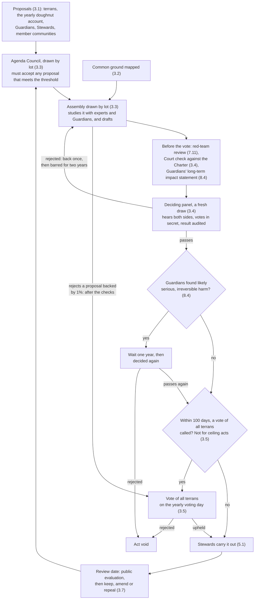

# Article 3 — How Terrans Decide

*One of the nine [Articles of Terra](README.md) in [The Terran Charter](../CHARTER.md) · [Commentary](../commentary/articles.md#article-3--how-terrans-decide)*

Terrans make planetary decisions through panels drawn by lot, after open deliberation. Enough terrans together can force a vote of all terrans, and no single body holds enough power to rule alone.

<!-- numbers: long-view-wait="one year" veto-days="100 days" vote-petition="1%" rejected-wait="two years" -->

A panel that rejects an act sends it back to its assembly once. If the Guardians find likely serious, irreversible harm, the act waits [a year][long-view-wait] and is decided again. Enough terrans can call any act except a ceiling act to a vote of all terrans; the Stewards act once no vote is called, or once the vote upholds it.

1. **Anyone may propose.** Any terran may put forward a proposal, and so may the Stewards, the Guardians, and member communities. A proposal backed by [100,000][answer-signatures] terrans of voting age receives a reasoned public answer from the Agenda Council within [90 days][answer-days]. One backed by [one million][assembly-signatures] terrans of voting age across [a quarter of the regions][petition-spread] goes to an assembly. If the assembly rejects a proposal backed by [1%][vote-petition] of terrans of voting age, the proposal goes to a vote of all terrans on the yearly voting day, after the checks in 3.4. Proposals on the ceiling cannot take this route. Signatures count if they are gathered within [twelve months][signature-window].
2. **Common ground first.** Open online discussion maps where terrans agree and disagree, so debate starts from what they share. Every assembly takes the maps as input.
3. **Assemblies chosen by lot.** For each planetary power listed in 2.4, a standing assembly of [450][assembly-size] terrans drawn by lot studies proposals with experts and Guardians and drafts planetary law. A Budget Assembly of [450][assembly-size] drafts the planetary budget and reconciles acts that conflict. An Agenda Council of [300][agenda-size], also drawn by lot, assigns proposals to assemblies; it must accept any proposal that meets 3.1's [one-million][assembly-signatures] threshold, and publishes its reasons. Members of the assemblies and the Agenda Council serve [three years][assembly-term], with equal shares replaced every [six months][assembly-rotation]. Different people recruit, brief, and facilitate members, and all are rotated and audited.
4. **Terrans decide.** Each act an assembly drafts goes, exactly as the assembly wrote it, to a fresh panel of at least [1,000][panel-size] terrans drawn by lot. Before the vote, the Planetary Court checks the act against this Charter, and an act that fails returns to its assembly. The panel hears advocates for and against, chosen by the assembly's majority and minority, then votes in secret. A majority decides, except where this Charter requires more. An act a panel rejects returns to its assembly once; if rejected again, it may not return for [two years][rejected-wait].
5. **A vote of all terrans.** An act a panel passes takes effect unless, within [100 days][veto-days], [0.5%][veto-petition] of terrans of voting age across [a quarter of the regions][petition-spread], or [a quarter][veto-council] of the Council of Communities, call a vote of all terrans. Ceiling acts cannot be called to such a vote. Votes of all terrans are held together on one voting day each year, and a challenged act waits until then. The assembly concerned words the question and writes a fair summary, with the case for and against in each side's own words. Terrans of voting age, as a planetary act sets it (Schedule 2), may sign and vote.
6. **The ceiling.** Ceiling acts set limits within the Earth Science Panel's range (Part III), and Schedule 4 records both. Each needs [two-thirds][ceiling-majority] of a panel of at least [3,000][ceiling-panel], and a majority of the Council of Communities, including a majority of delegates from lower-footprint regions and a majority from higher-footprint regions. The Statistics Office classes regions each year by their footprint per person on the planetary boundaries. If the Planetary Court finds a ceiling act outside the science's range, the act is void. A planetary fund pays poorer communities' costs of complying.
7. **Decisions are versions.** Every planetary act carries a version number, a public history, and a review date. At review it is evaluated in public, and stays in force unless a deciding panel passes an amendment or repeal drafted by its assembly. Emergency measures, urgent acts, and acts that say so lapse unless renewed. Ceiling limits and the ban on weapons of mass destruction never lapse, and ceiling limits loosen only as the science allows.
8. **Rules anyone can run.** Rules that set numbers, such as tax bands, the wealth limit, pay ratios, and eligibility for the floor, are also published as code anyone can run. Where code and text differ, the text prevails. Any adverse decision gets a human review on request.

*Assemblies chosen by lot draw on Ireland's citizens' assemblies and Ostbelgien's standing citizens' council, and mapping common ground on Taiwan's vTaiwan. Deciding panels draw on Mongolia's deliberative polls, and the vote of all terrans on Switzerland's optional referendum. Versioned decisions draw on open-source projects.*

[← Article 2: Working Together](2-working-together.md) · [All Articles](README.md) · [Article 4: Votes, Draws and Offices →](4-votes-draws-and-offices.md)

[agenda-size]: ../schedules/2-settings.md#agenda-size
[answer-days]: ../schedules/2-settings.md#answer-days
[answer-signatures]: ../schedules/2-settings.md#answer-signatures
[assembly-rotation]: ../schedules/2-settings.md#assembly-rotation
[assembly-signatures]: ../schedules/1-safeguards.md#assembly-signatures
[assembly-size]: ../schedules/2-settings.md#assembly-size
[assembly-term]: ../schedules/2-settings.md#assembly-term
[ceiling-majority]: ../schedules/1-safeguards.md#ceiling-majority
[ceiling-panel]: ../schedules/1-safeguards.md#ceiling-panel
[long-view-wait]: ../schedules/1-safeguards.md#long-view-wait
[panel-size]: ../schedules/1-safeguards.md#panel-size
[petition-spread]: ../schedules/1-safeguards.md#petition-spread
[rejected-wait]: ../schedules/2-settings.md#rejected-wait
[signature-window]: ../schedules/1-safeguards.md#signature-window
[veto-council]: ../schedules/1-safeguards.md#veto-council
[veto-days]: ../schedules/1-safeguards.md#veto-days
[veto-petition]: ../schedules/1-safeguards.md#veto-petition
[vote-petition]: ../schedules/1-safeguards.md#vote-petition
