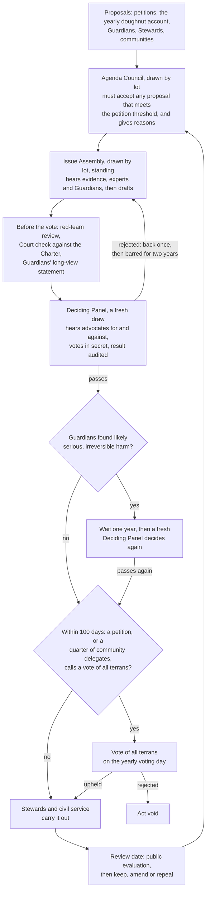
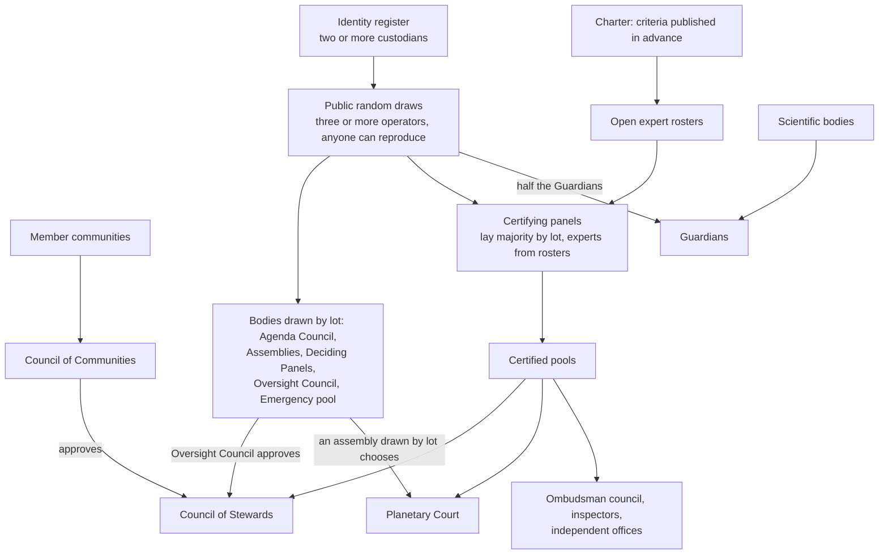

# A modern Terran government

*Proposal for the next draft of Parts IV, VII–X and XII · drafted by Claude from the second research round, 11 October 2026, revised after adversarial review · **adopted into the [second working draft](../CHARTER.md) on 12 October 2026, with its recommended defaults and the further choices listed in the [changelog](../CHANGELOG.md)**; clause numbers in the Charter differ from the draft wording below*

**The proposal:** replace "every terran votes on every question" with a division of labour.

- **Samples of terrans drawn by lot** draft and decide ordinary planetary law.
- **Every terran can force a vote of all terrans** by petition, and the Charter changes only by such votes.
- **A council of community delegates** holds a second key on the biggest decisions.
- **A college of seven Stewards** runs a small civil service hired on merit.
- **Communities decide everything** not on a short planetary list.

On the research's estimates, ordinary planetary law would cost the average adult 3–6 seconds of attention a year. Universal voting at a legislature's load would cost 9–160 hours. The planetary institutions would cost about $0.60–2.10 per terran a year, or $1.80–3.90 with one in-person planetary voting day a year.

Binding decisions by samples drawn by lot have never been tried at any scale. So each body earns binding power stage by stage, after an independent evaluation.

## Terms used here

| Term | Meaning |
| --- | --- |
| Drawn by lot (sortition) | Chosen at random from all terrans, like jury duty |
| Stratified | Drawn so the sample matches set traits, such as region, age, gender, education and language |
| Deliberative poll | A random sample surveyed before and after a weekend of balanced briefings and discussion |
| Opinion map | A Polis-style map of where people agree and disagree |
| Implementing rules | The detailed rules staff write under an act, like regulations under a statute |
| Call in | Pull a staff rule back so an assembly decides it |
| Residual rule | Anything not on the planetary list belongs to communities |
| Collegial | Decides as a group, with no single leader |
| Certified pool | A list of candidates an independent panel has checked against published criteria |
| Two-key decision | Needs approval from two separate bodies, so capturing one isn't enough |
| For-cause removal | Removable only for proven misconduct |

## Why the draft's design can't work at planetary scale

The draft asks every terran to vote on "the questions before the Commonwealth" (VII.3). The numbers rule that out ([scale](../research/scale-and-federalism.md)).

- **Most binding rules aren't laws.** In 2024 the EU adopted 146 of its 2,589 acts (5.6%) by its ordinary legislative procedure. In the US, Congress passes about 159 laws a year against about 3,168 final agency rules, so statutes are about 5% of the total.
- **Universal voting at a legislature's load would cost each adult about 9–160 hours a year**, an estimate. Even Switzerland, the most practised direct democracy, handles 8.6 questions a year at 48.8% turnout.
- **One in-person planetary vote would reach about 5.9 billion adults.** By the note's estimates, it would need roughly 6 million polling stations. Official running costs would be about $10–15 billion at India's cost per voter, from a pre-election projection. And 2.2 billion people are offline.
- **All-member votes are rare even in self-governing online communities.** Debian has held 33 general resolutions since 2003, about 1.4 a year ([modern governance](../research/modern-governance.md)).

On these numbers, a universal vote works for about ten questions a year at most, while a planetary government faces dozens of laws and thousands of rules.

## What "modern" means here

Most constitutions still run on 18th-century machinery: elections, representative assemblies and fixed mandates. The research points to a different set of principles. Each has a known way to fail, and most rest on thin or mixed evidence (grades below).

| Principle | Precedent | Known failure |
| --- | --- | --- |
| A narrow top over nested units | Swiss and Nigerian lists of central powers; Apache's board over project committees | Work nobody owns piles onto the top; an umpire that never rules |
| Samples deliberate and decide; everyone can force a vote | Swiss optional referendum (most acts take effect without a vote); Mongolia's required deliberative polls | Binding samples are untested; samples that are ignored lose legitimacy |
| Split roles | Bouricius's 2013 multi-body design (untested as a whole) | Staff capture, as in France's climate convention; coordination costs |
| Small, removable councils | Python's steering council (removable by two-thirds of voters) | An unaccountable top; oligarchy |
| Decisions as versions with review dates | Rust's evaluation dates; Texas's sunset reviews of agencies | Reviews become formalities |
| Powers that lapse unless renewed | Swiss urgent acts (Art. 165); South Africa's 21-day emergencies | Routing around the limit through a softer law |
| Rules published as code, with the text supreme | France's income-tax compiler | Automating an unlawful rule: Australia refunded A$746 million and wrote off A$1.751 billion of debts after Robodebt |
| Measurement drives revision | The Montreal Protocol's science reviews and binding adjustments | Gaming, lags and broken data pipelines |
| Participation with a guaranteed answer | UK e-petitions; Taiwan's Join platform | Little changes: 1.5% of published UK petitions were debated in 2019–24 |

Sources: [scale](../research/scale-and-federalism.md), [sortition](../research/sortition-at-scale.md), [decision mechanisms](../research/decision-mechanisms.md), [polycentric](../research/polycentric-governance.md), [executive](../research/executive-and-administration.md), [failure modes](../research/failure-modes.md), [modern governance](../research/modern-governance.md).

## The architecture

### What is planetary

The Commonwealth decides only a short list. Everything else belongs to communities, territorial or by membership, and whoever benefits from a service pays for it ([scale](../research/scale-and-federalism.md), [polycentric](../research/polycentric-governance.md)).

1. The ceiling and its fair shares, with the timelines for reaching them
2. The ban on weapons of mass destruction, and its verification
3. Minimum defences against pandemics and other risks only as strong as their weakest point
4. Financing the floor, the wealth limit and planetary revenue
5. Common standards for identity, voting and measurement
6. The Commonwealth's own money, if it adopts one

The Planetary Court umpires what counts as planetary, rights under the Charter, and disputes between communities. It doesn't wait to be asked: if a quarter of member communities object that an act isn't planetary, the Court must rule within [90] days.

Membership-based communities work for culture, language and schooling. Land, water and air stay territorial, because the research found no membership-based body governing them.

### How a planetary act is made

**Implementing rules.** Most binding rules are implementing rules, so they get their own route.

1. The civil service publishes each draft. Comments count only from verified or sampled people, not by raw volume: one US rulemaking drew nearly 18 million fake comments out of more than 22 million.
2. A sampled review panel of [200] terrans checks the draft for its Issue Assembly.
3. The rule takes effect after an objection window, unless the Assembly calls it in. [100,000] terrans or [a tenth of] communities can force a call-in.
4. The act that delegates the rule defines what counts as routine.

**Coherence.** A Budget Assembly drawn by lot sets the overall planetary budget and reconciles acts that conflict. Its Deciding Panel approves the budget.

### The bodies

Sizes and terms in square brackets are starting points from the research, for Kara to set. Every body drawn by lot is stratified by region, age, gender, education and language group.

| Body | Who sits | How chosen | Term | Job (one power each, VIII.8) |
| --- | --- | --- | --- | --- |
| **All terrans** | Everyone of voting age | — | — | Charter amendments, including the principle for sharing the ceiling; votes called by petition or by community delegates; all on one yearly voting day |
| **Agenda Council** | [300] | Lot | [3] years; a sixth replaced every six months | Sorts proposals and assigns them; must accept any proposal that meets the threshold, and publishes reasons for every decision |
| **Issue Assemblies**, one per listed power (5–6), plus a **Budget Assembly** | [450] each | Lot | [3] years, staggered, with reserves drawn at the same time | Hear evidence, experts and Guardians; draft planetary law; call in implementing rules |
| **Deciding Panels**, one per act | At least [1,000]; at least [3,000] for ceiling acts | A fresh draw for each act; names withheld until after the vote | Days | Hear advocates chosen by the Assembly's majority and minority, read the red-team review, then vote in secret |
| **Council of Communities** | [200] delegates from [at least 10] regions | Each region's member communities choose their delegates by their own method | [2–4] years, staggered; recallable | Second key on ceiling acts and Steward appointments; a quarter of its delegates can call a vote of all terrans |
| **Oversight Council** | [150] | Lot | [2] years, staggered | Approves and removes Stewards with the Council of Communities; reviews the Stewards' work in public hearings |
| **Emergency pool** | [10,000] on call | Lot, drawn yearly | 1 year | A [1,000]-member panel is drawn from it by public lottery when an emergency is declared, to confirm or end it |
| **Council of Stewards** | [7], no more than [2] from one region | From a certified pool, approved by both the Oversight Council and the Council of Communities after public hearings | One [6]-year term, staggered | Carries out planetary acts; proposes acts; declares emergencies; holds no veto; commands no army |
| **Civil service** | [30,000–60,000] staff across all planetary bodies | Open competitive exams, with regional spread targets | Career; protected from political dismissal | Delivers programmes; drafts implementing rules |
| **Independent offices**: Audit, Statistics, Identity and Voting, Earth Science Panel | Professionals; the Science Panel adds lay reviewers drawn by lot | Lot from certified pools | Fixed terms; for-cause removal | Audits, including of every lottery; the yearly doughnut account; the identity register and votes; ceiling science |
| **Planetary Court** | A fixed number of judges, set in the Charter | As IX.2 says: an assembly drawn by lot chooses from certified candidates | One [12]-year term, staggered; seated automatically | Charter rights, what counts as planetary, disputes between communities; pre-vote Charter checks |
| **Inspectors** | Professionals | Certified pools | Fixed terms | Investigate breaches; answer to the Court (IX.3) |
| **Ombudsman council**, with a red team | [3–5] ombudsmen | Lot from a certified pool | Fixed terms; for-cause removal; automatic acting successor | Investigates any institution; red-teams major proposals before they are decided |
| **Guardians** | As in X.3: half drawn by lot, half nominated by scientific bodies | As in X.3 | Staggered | Long-view statements; can trigger the one-year delay |

**Stewards in detail.** Two or three seats fall vacant every two years, and each must be approved by both councils. A Steward holds over until a successor is approved. If no successor is approved within six months, the seat is filled by lot from candidates either council approved. Either council can remove a Steward by two-thirds. No member of the Oversight Council may become a Steward within [five] years, and the Court can remove council members for misconduct.

### Root of trust

Every body drawn by lot, every certified pool and every vote depends on a few foundations. Each is spread so that no single compromise breaks the system:

- **Criteria written in the Charter.** Pools are certified against criteria published in advance, and refusals can be appealed to the Court.
- **Open expert rosters.** Anyone meeting the published criteria may enrol.
- **Certifying panels.** Each is drawn for one round only: a lay majority by lot, plus experts drawn from the rosters. Each publishes its reasons, and no one sits on two.
- **Public random draws.** Each draw uses a public random seed and is run in parallel by at least [three] independent operators. Anyone can reproduce it, and no body oversees the draws for its own seats.
- **The identity register.** It is kept by at least [two] independent custodians, audited yearly, with a paper fallback.

### The ceiling: run like the Montreal Protocol, for now

The Montreal Protocol is the clearest working precedent for a planetary limit, though so far only for ozone.

- **It has 198 parties.** They seek consensus first.
- **As a last resort, a vote adjusts existing controls.** An adjustment needs two-thirds of the parties present and voting, including majorities of developing (Article 5) and other parties, and then binds every party.
- **New controls work differently.** They need amendments, which bind only those who ratify.
- **Its compliance fund costs about 4 US cents per person a year**, at its 2024–26 budget of $965 million.
- **Atmospheric monitoring caught hidden CFC-11 production.**

Source: [polycentric](../research/polycentric-governance.md).

Applied to the Charter:

- **The science.** The Earth Science Panel publishes the science and a recommended range for each boundary, through an open review every four years. Boundary values are judgements about acceptable risk, so the science advises and terrans decide within the range ([floor and ceiling](../research/floor-and-ceiling.md)).
- **The sharing principle.** The principle for dividing the ceiling into fair shares is part of the Charter. It is adopted and revised only as a Charter amendment under XI.3.
- **Adjustments.** The Ceiling Assembly drafts adjustments within the range and the principle. Each needs two keys:
    - two-thirds of a Deciding Panel of at least [3,000]
    - a majority of the Council of Communities, including majorities of delegates from both lower-footprint and higher-footprint communities

    Communities stand in for Montreal's two groups of parties.
- **Challenges.** Ceiling acts can be sent to a vote of all terrans only on a Court finding that they depart from the science, so a majority can't vote down a tightening the science requires.
- **Compliance.** A planetary fund pays poorer communities' cost of complying.

### Emergencies that expire

The draft has no emergency clause, and emergencies are the main path to rule by decree. One study found democracies were 75% more likely to erode under a state of emergency. More executive emergency power went with more disaster deaths, not fewer ([failure modes](../research/failure-modes.md)). The proposed clause:

- **Declaration.** The Stewards, by a majority of the Council, may declare an emergency for a hazard on a published list, for up to 21 days, published at once.
- **Confirmation.** A panel of [1,000], drawn by public lottery from the Emergency pool, must confirm it within 7 days or it ends.
- **Extensions.** Each lasts at most three months. The first needs a majority, the second 60%, and each later one ten points more. None may follow one passed at 90%.
- **Scope by effect.** Any measure that suspends a right or bypasses ordinary procedure is an emergency measure, whatever law it uses. South Africa's government used a disaster law instead of its 21-day emergency rules, for 750 days.
- **Hard limits.** No emergency may change the Charter, postpone a vote, or stop the Court or the Ombudsman council.
- **Review and inquiry.** The Planetary Court may review any emergency or measure. Every emergency measure lapses with the emergency, and an inquiry with hearing powers follows.
- **Urgent laws.** Only a Deciding Panel may declare an act urgent, so that it takes effect at once; the Stewards may not. An urgent act carries an end date and lapses within a year unless a regular Deciding Panel ratifies it. Once refused, it may not be renewed. Swiss urgent acts, under Art. 165, likewise take effect at once and must be time-limited. If a referendum is requested, they lapse after a year unless voters approve, and a rejected act can't be renewed.
- **Continuity.** If the Stewards or the councils can't act, a panel drawn from the Emergency pool acts for at most 90 days. It can't change the Charter, postpone votes or extend itself.

### Decisions as versions

- **Version and review.** Every planetary act carries a version number, a public history and a review date. At review, it is evaluated in public and stays in force unless a Deciding Panel amends or repeals it.
- **What lapses.** Only emergency measures, urgent acts and acts that say so lapse unless renewed. Ceiling limits and the ban on weapons of mass destruction never lapse; they loosen only as the science allows (III, XI.4). Automatic sunsets are kept narrow on purpose: the research found sunsets mostly mobilise an act's defenders rather than its critics ([modern governance](../research/modern-governance.md)).
- **Rules as code.** Rules that set numbers, such as tax bands, the wealth limit, pay ratios and eligibility for the floor, are also published as official code anyone can run. The text prevails, an independent auditor checks the code, and any adverse decision gets a human review on request.
- **A yearly doughnut account.** The Statistics Office publishes one each year. A worsening indicator triggers a Guardian review with a deadline, and institutions follow or explain under X.5.

### What keeps it honest

The threat model lists eight safeguards to keep even while streamlining everything else ([failure modes](../research/failure-modes.md)). This design keeps six in full and two in part:

1. **Rival centres.** Communities keep their own governments, courts and revenue, and hold a key through the Council of Communities. *Kept.*
2. **Self-expiring emergency powers**, as above. *Kept.*
3. **A collegial, removable executive** whose single term counts any part of a term. *Kept.*
4. **An umpire with no single chokepoint.** The Court's size is fixed, judges are seated automatically, terms are staggered, and objections from communities force a ruling. *Kept.*
5. **Independent inspectors** with for-cause tenure, budgets fixed in the Charter, and automatic acting successors. *Kept.*
6. **Repair channels no emergency can suspend**: scheduled votes and access to the courts. *Partly kept.* After stage three no outside review exists, because there is no "abroad".
7. **Plural, open, auditable infrastructure**: several lottery operators, two or more register custodians, offline routes to every service, and open AI mediators that are red-teamed. *Kept.*
8. **A way out.** After stage three, a tripwire restores a community's right to leave if the safeguards fail. *Partly kept.* Its terms are set below, but leaving a planetary ceiling is never clean.

## What it costs, in money and attention

All figures are estimates, built from the research notes' figures, with assumptions stated.

**Money.**

| Body | Assumption | Member-days a year |
| --- | --- | --- |
| Issue Assemblies and Budget Assembly | 6–7 bodies of 450 members, 200 sitting days | 540,000–630,000 |
| Deciding Panels | 20–60 acts a year; panels averaging 1,000–2,500 members; 2–3 days | 40,000–450,000 |
| Rule-review panels | 20–60 a year of 200 members, 2 days | 8,000–24,000 |
| Agenda and Oversight Councils | 450 members, 200 sitting days | 90,000 |
| Council of Communities | 200 delegates, 100 sitting days | 20,000 |
| **Total** | | **698,000–1,214,000** |

At €736 per member-session (Madrid, 2019) to about €1,861 per member-day (France's climate convention, assuming 24 paid days), that is €0.51–2.26 billion a year ([sortition](../research/sortition-at-scale.md)). At the ECB reference rate of 9 October 2026, $1.1206 to the euro ([wealth and tax](../research/wealth-and-tax.md)), it comes to $0.58–2.53 billion.

The executive, the civil service and the other planetary bodies' staff add $4.5–15 billion ([executive](../research/executive-and-administration.md)). The total is about $5–17.5 billion a year: $0.60–2.10 per terran, at the UN's 8.3 billion people for mid-2026. By comparison, the whole UN system cost $7.84 per terran in 2025.

These figures exclude transfers to finance the floor, the digital backbone, interpretation and travel, emergency panels, and universal votes.

**Universal votes are the expensive part.** One in-person planetary vote would cost about $10–15 billion, as much as eight months to three years of the planetary executive. With one voting day a year, total cost rises to about $1.80–3.90 per terran. That is why all universal questions share one fixed voting day: it caps the cost and lifts turnout. Dutch water-board turnout was about 24% in a standalone 2008 vote, by an MP's account. Held alongside provincial elections, it reached 43.5% in 2015 and 53.61% in 2023 ([polycentric](../research/polycentric-governance.md)).

**Attention.** Ordinary planetary law takes 698,000–1,214,000 member-days a year. At 8 hours a day, spread over 5.9 billion adults, that is about 3–6 seconds per adult per year. The yearly voting day adds 15–60 minutes per question for those who vote.

**Who serves.** The table above opens about 25,000–163,000 seats a year:

- 20,000–150,000 on Deciding Panels
- 4,000–12,000 on rule-review panels
- 900–1,050 new Assembly members
- 175 on the two councils

Over 60 adult years, against 6.1 billion people aged 15 or over (2024), roughly one adult in 630–4,100 would serve at least once.

That is the trade. Samples match the population on the traits they are drawn by, but only 2–5% of those invited typically accept, so volunteers' traits creep in. And they reach few people directly. That's why the petition, local self-government, and open inputs to every Assembly matter ([decision mechanisms](../research/decision-mechanisms.md), [sortition](../research/sortition-at-scale.md)).

## How it phases in

Binding decisions by samples have no track record. Every standing body drawn by lot today is advisory and takes one to three topics a year. Typically only 2–5% of those invited say yes, and Ostbelgien's rate fell from 11.5% to 3.75% ([sortition](../research/sortition-at-scale.md)). So the design proves itself the way the Commonwealth grows (Part XII):

| Stage | Binding | Advisory |
| --- | --- | --- |
| **One**: from the first members | The Court; emergency rules; choosing the Stewards; identity and voting standards; ceiling adjustments, within the Science Panel's range and with the Council of Communities' key, because XII.2 binds members to the ceiling from the start | All other Issue Assemblies and the Budget Assembly |
| **Two**: half of humanity | Assemblies and Deciding Panels for the floor, the wealth limit, revenue and the budget, once each passes an independent evaluation | The remaining listed powers |
| **Three**: nine in ten | The full list | — |

The Audit Office evaluates each body against criteria published before each stage. Until a body passes, its acts need both a Deciding Panel and approval on the yearly voting day.

## Draft wording for the next draft

These are candidate clauses in the Charter's voice. Bracketed numbers are placeholders.

> **Part VIII opening.** Terrans make planetary decisions through panels drawn by lot, after open deliberation; every terran can force a vote of all terrans, and no single body holds enough power to rule alone.

> **IV.5 (last sentence).** Terrans set the exact rates by planetary act (VIII.4).

> **VII.3 Decided by samples, checked by all.** Terrans decide planetary questions through panels of terrans drawn by lot, chosen fresh for each decision. Any planetary act can be sent to a vote of all terrans by petition, and this Charter changes only by such votes.

> **VII.4 Decisions close to home.** The Commonwealth decides only what this Charter lists as planetary:
> - the ceiling and its fair shares;
> - the ban on weapons of mass destruction and its verification;
> - minimum defences against pandemics and other risks only as strong as their weakest point;
> - financing the floor, the wealth limit and planetary revenue;
> - common standards for identity, voting and measurement;
> - the Commonwealth's own money, if it has one.
>
> Everything else belongs to communities. The Planetary Court settles what is planetary, and must rule within [90] days when [a quarter of] member communities object.

> **VIII.1 Anyone may propose.** Any terran may put forward a proposal. One backed by [100,000] terrans of voting age receives a reasoned public answer within [90] days. One backed by [one million] terrans across [a quarter of] regions goes to an assembly. If the assembly rejects a proposal backed by [1%] of terrans of voting age, it goes to the yearly vote.

> **VIII.3 Assemblies chosen by lot.** For each listed planetary power, a standing Assembly of [450] terrans drawn by lot studies proposals with experts and Guardians and drafts planetary law. Members serve [three] years, a sixth replaced every six months. Those who recruit, brief and facilitate are separate people, rotated and audited.

> **VIII.4 Terrans decide.** Each act an Assembly drafts goes to a fresh panel of at least [1,000] terrans drawn by lot. The panel hears advocates for and against, then votes in secret, and a majority decides. Acts on the ceiling need two-thirds of a panel of at least [3,000], and a majority of the Council of Communities, including majorities of delegates from lower-footprint and higher-footprint communities. An act takes effect unless, within [100] days, [0.5%] of terrans of voting age across [a quarter of] regions, or [a quarter of] the Council of Communities, call a vote of all terrans. It is then decided on the yearly voting day. A ceiling act can be called to such a vote only if the Planetary Court finds it departs from the science.

> **VIII.7 Stewards carry out decisions.** A Council of [seven] Stewards, no more than [two] from one region, carries out planetary acts, holds no veto over them, and commands no army. Each heads a department and serves one [six]-year term, counting any part of a term; two or three seats are filled every two years. Each Steward is chosen from a certified pool after public hearings, and needs the approval of both the Oversight Council and the Council of Communities. Either council may remove a Steward by two-thirds.

> **VIII.8 Separate powers.** Assemblies drawn by lot draft planetary law; panels drawn by lot decide it; the Council of Communities holds a second key; the Stewards and civil service administer, and make rules only under an act, which any Assembly can call in; courts judge; the Guardians speak for those who cannot vote; and the Ombudsman council investigates. No person or body holds more than one of these powers.

> **VIII.11 Emergencies expire.** The Stewards, by a majority of the Council, may declare an emergency for a hazard listed in [schedule] for up to 21 days, published at once. It ends unless a panel drawn by lot from a pool chosen in advance confirms it within seven days. Each extension lasts at most three months: the first needs a majority, the second 60%, and each later one ten points more. None may follow one passed at 90%. Any measure that suspends a right or bypasses ordinary procedure is an emergency measure, whatever law it uses. The Planetary Court may review any emergency or measure. No emergency may change this Charter, postpone a vote, or stop the Court or the Ombudsman council. Every emergency measure lapses with it, and an inquiry with hearing powers follows.

> **VIII.12 Decisions are versions.** Every planetary act carries a version number, a public history and a review date. At review it is evaluated in public, and stays in force unless a panel amends or repeals it. Emergency measures, urgent acts and acts that say so lapse unless renewed. Ceiling limits and the ban on weapons of mass destruction never lapse, and loosen only as the science allows. Rules that set numbers are also published as code anyone can run; where code and text differ, the text prevails.

> **IX.2 Judges.** Judges are chosen by an assembly drawn by lot, from candidates certified as qualified. The Court has [a fixed number of] judges. Each serves one [twelve]-year term, staggered, and is seated automatically once chosen. A judge may be removed only for proven misconduct, by two-thirds of the other judges after an independent review.

> **X.4 The long-view test.** Every planetary act carries the Guardians' long-term statement, prepared by independent scientists. If the Guardians find likely serious, irreversible harm, the act waits one year, and a fresh panel decides it again.

> **XII.7 Proven before binding.** Each planetary body begins in advisory form, except those needed from stage one. It gains binding power only after an independent evaluation against criteria published in advance.

> **XII.8 A way out if safeguards fail.** After stage three, the Ombudsman council or [a quarter of] the Council of Communities may certify that a scheduled vote was postponed, an emergency ran past its last permitted extension, or the Court could not sit for [90] days. Any community may then leave Commonwealth institutions. Its people keep their floor rights, and it keeps its ceiling duties.

The design also takes up changes proposed elsewhere in the repository:

- **From [OPEN-QUESTIONS.md](../OPEN-QUESTIONS.md):** VIII.5's voting order, k-of-n voting keys, and a hand count, not a new vote, where a paper audit fails (VIII.6).
- **From [failure modes](../research/failure-modes.md):** a fixed Court size with automatic seating (IX.2).
- **Replacing VIII.9's single Ombudsman with an Ombudsman council and red team**, while inspectors keep answering to the Court (IX.3).
- **Replacing the Part VIII diagram** with the one above.

## What's proven and what's a bet

Grades follow the research notes:

- **A:** binding at national scale or larger for 10+ years, with outcome data
- **B:** real use with measured results, but advisory, local or short-lived
- **C:** pilots, self-reports, or an untested combination of proven parts
- **D:** theory only, or a record of failure

| Element | Grade | Closest precedent | Biggest risk |
| --- | --- | --- | --- |
| A short planetary list with a residual rule | A nationally; untested planetarily | Swiss and Nigerian constitutions | An umpire that never rules: the EU's court has never voided a measure on subsidiarity |
| A vote of all terrans on demand | A on parliaments; untested on bodies drawn by lot | Switzerland: 127 of 218 challenged acts survived | Organized money picks the targets |
| Montreal-style ceiling | A for ozone; untested for other boundaries or with panels | Montreal Protocol | Climate pledges reach only 12% below 2019 levels by 2035; donors stop paying |
| A council of community delegates choosing the executive | A for parliaments electing an executive | Swiss Federal Council | Two-key approval with a council drawn by lot is untested |
| A small merit civil service | A | Cross-national evidence on merit recruitment | Capture through hiring |
| Assemblies drawn by lot that draft | B (advisory only) | Ireland, Ostbelgien, Paris | Staff capture; falling response rates |
| Binding Deciding Panels | C (components only, never combined) | Swiss vetoes; Mongolia's deliberative polls | Legitimacy; pressure on members |
| Judges chosen by an assembly drawn by lot | D | No modern state; the nearest design, judges by lot, lost 68–32 in Switzerland in 2021 | Legitimacy; capture of the certifying panel |
| Emergency limits | B | South Africa's s.37; Swiss Art. 165 | Routing around them through softer laws |
| Versioned decisions; rules as code; the doughnut account | C | Rust; France's tax code; PIK's planetary check | Formal reviews; automated error; gamed indicators |
| An identity register with plural custodians | C | Estonia and India run single-custodian systems | Exclusion; compromise of a custodian |

Sources for each row are in the research notes linked above.

## Choices for Kara

1. **How binding should samples be, and when?** The proposal binds only where stage one needs it, and elsewhere after evaluation. The alternative is that samples only ever advise and an elected or delegated body decides. That is safer, but it rebuilds the 18th-century template.
2. **Keep the Council of Communities?** It is the one traditional body here, kept because the evidence for delegate-chosen executives is strongest and because it gives communities a key. The executive note rates delegates electing the Stewards "the best-evidenced route". The leaner alternative drops it: the Oversight Council alone chooses the Stewards, and the ceiling's two majorities are computed inside larger panels.
3. **What are the regions?** Sampling, spread rules and the Stewards' "no more than two" rule all need a fixed set of at least ten world regions. An existing statistical classification would do at first. Regions differ several-fold in size.
4. **How easy should a vote of all terrans be?** [0.5%] of terrans of voting age is about 30 million signatures; the Swiss share is about 0.9%. A threshold near 1% stalled nearly everything on Madrid's platform. And V.2 bars organizations from funding signature drives.
5. **What does service by lot look like?** Pay so far runs from a flat US$600 stipend for the whole 68-hour 2021 Global Assembly to Guerrero's proposed $500,000 a year. Is service a duty or voluntary? What job protection does it carry?
6. **Is standing a birthright or earned?** Each of the five self-governing communities the research studied earns its electorate by contribution. The Charter gives standing at birth (I.1). The proposal keeps that, with a minimum age for service.

## Read more

The seven research notes behind this proposal:

- [scale-and-federalism.md](../research/scale-and-federalism.md)
- [polycentric-governance.md](../research/polycentric-governance.md)
- [sortition-at-scale.md](../research/sortition-at-scale.md)
- [executive-and-administration.md](../research/executive-and-administration.md)
- [decision-mechanisms.md](../research/decision-mechanisms.md)
- [failure-modes.md](../research/failure-modes.md)
- [modern-governance.md](../research/modern-governance.md)

From the first round, this proposal builds on:

- [deliberation](../research/deliberation.md)
- [digital voting](../research/digital-voting.md)
- [accountability](../research/accountability.md)
- [living charter](../research/living-charter.md)
- [long view](../research/long-view.md), for the Guardians' delay
- [floor and ceiling](../research/floor-and-ceiling.md), for the sharing principle and why boundary values are judgements
